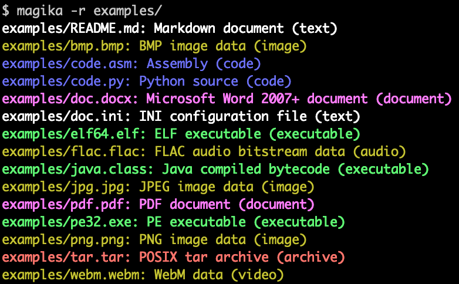

# Magika

[English](README.md) | [简体中文](README.zh.md)

[](https://pypi.python.org/pypi/magika)
[](https://npmjs.com/package/magika)
[](https://pypi.python.org/pypi/magika)
[](https://pypi.python.org/pypi/magika)
[](https://pkg.go.dev/github.com/google/magika/go)
<!-- [](https://scorecard.dev/viewer/?uri=github.com/google/magika) -->
[](https://www.bestpractices.dev/en/projects/8706)

[](https://coveralls.io/github/google/magika?branch=main)
[](https://github.com/google/magika/actions)
[](https://pepy.tech/projects/magika)
[](https://pepy.tech/projects/magika)

Magika 是一款基于人工智能的新型文件类型检测工具，借助深度学习的前沿进展提供高精度的检测能力。在底层架构上，Magika 采用了一套定制化且高度优化的轻量级模型，体积仅数 MB，即便在单核 CPU 上运行也能在数毫秒内精准识别文件。Magika 在涵盖 200+ 种内容类型（兼顾二进制与纯文本格式）的约 1 亿个样本数据集上完成了训练与评测，在官方测试集上取得了约 99% 的平均准确率。

以下是 Magika 命令行工具输出的示例：

<p align="center">
    
</p>

Magika 在 Google 内部得到了大规模生产部署，通过将 Gmail、Google Drive 和 Google 安全浏览（Safe Browsing）中的海量文件准确路由至对应的安全与内容合规策略扫描器，每周处理数百亿个样本，切实保障广大用户的安全。此外，Magika 还已集成至 [VirusTotal](https://www.virustotal.com/)（[示例](./assets/magika-vt.png)）与 [abuse.ch](https://bazaar.abuse.ch/)（[示例](./assets/magika-abusech.png)）。

如需了解更多背景信息，您可以阅读我们最初在 [Google 开源博客上的发布博文](https://opensource.googleblog.com/2024/02/magika-ai-powered-fast-and-efficient-file-type-identification.html)，查阅 [Magika 官方网站](https://securityresearch.google/magika/)，或阅读发表于国际软件工程大会 IEEE/ACM ICSE 2025 的[学术研究论文](https://securityresearch.google/magika/additional-resources/research-papers-and-citation/)。

您无需安装任何依赖，即可直接体验在浏览器本地运行的 [Web 在线演示](https://securityresearch.google/magika/demo/magika-demo/)！


# 核心亮点

- 提供基于 Rust 编写的命令行工具（CLI）、Python API，以及 Rust、JavaScript/TypeScript（包含支持 [Web 在线演示](https://securityresearch.google/magika/demo/magika-demo/) 的实验性 npm 包）和 GoLang（开发中）的官方绑定。
- 在覆盖 [200+ 种内容类型](./assets/models/standard_v3_3/README.md) 的约 1 亿个文件数据集上完成严密训练与评估。
- 在测试集上，Magika 实现了约 99% 的平均精确率（Precision）与召回率（Recall），显著超越现有传统方法——尤其在文本类内容类型上优势显著。
- 模型加载完成后（此为单次启动开销），单文件推理时间在单核 CPU 上仅需约 5 毫秒。
- 支持同时传入成千上万个文件进行批处理分析；亦可使用 `-r` 参数递归扫描整个目录树。
- 推理时间与文件大小基本无关，呈现接近恒定的执行耗时；Magika 仅高效截取并分析文件内容的受限关键子集。
- 采用按内容类型定制的置信度阈值机制，智能判断是“信任”模型的细粒度预测，还是返回通用兜底标签（如“Generic text document 通用文本”或“Unknown binary data 未知二进制”）。
- 可通过多种预测模式灵活控制对误报的容忍度，例如 `high-confidence`（高置信度）、`medium-confidence`（中置信度）与 `best-guess`（最优推测）。
- 客户端与各类语言绑定均已全面开源，更多精彩功能敬请期待！

# 目录

1. [快速上手](#快速上手)
   1. [安装指南](#安装指南)
   1. [快速入门示例](#快速入门示例)
1. [详细文档](#详细文档)
1. [安全漏洞报告](#安全漏洞报告)
1. [开源许可证](#开源许可证)
1. [免责声明](#免责声明)

# 快速上手

## 安装指南

### 命令行工具（CLI）

Magika 提供了基于 Rust 编写的高性能 CLI 工具，支持多种安装方式：

通过 `magika` Python 包安装：
```shell
pipx install magika
```

通过 Homebrew 安装（macOS / Linux）：
```shell
brew install magika
```

通过官方安装脚本一键安装：
```shell
curl -LsSf https://securityresearch.google/magika/install.sh | sh
```

或在 Windows 上通过 PowerShell 安装：
```shell
powershell -ExecutionPolicy Bypass -c "irm https://securityresearch.google/magika/install.ps1 | iex"
```

通过 `magika-cli` Rust crates 安装：
```shell
cargo install --locked magika-cli
```

### Python 软件包

```shell
pip install magika
```

### JavaScript 软件包

```shell
npm install magika
```


## 快速入门示例

以下精选了若干快速上手示例供您参考。

如需深入探究 Magika 的内部运行机制，请参阅 Magika 官方网站上的[核心概念（Core Concepts）](https://securityresearch.google/magika/core-concepts/)章节。

### 命令行工具示例

```shell
% cd tests_data/basic && magika -r * | head
asm/code.asm: Assembly (code)
batch/simple.bat: DOS batch file (code)
c/code.c: C source (code)
css/code.css: CSS source (code)
csv/magika_test.csv: CSV document (code)
dockerfile/Dockerfile: Dockerfile (code)
docx/doc.docx: Microsoft Word 2007+ document (document)
docx/magika_test.docx: Microsoft Word 2007+ document (document)
eml/sample.eml: RFC 822 mail (text)
empty/empty_file: Empty file (inode)
```

```shell
% magika ./tests_data/basic/python/code.py --json
[
  {
    "path": "./tests_data/basic/python/code.py",
    "result": {
      "status": "ok",
      "value": {
        "dl": {
          "description": "Python source",
          "extensions": [
            "py",
            "pyi"
          ],
          "group": "code",
          "is_text": true,
          "label": "python",
          "mime_type": "text/x-python"
        },
        "output": {
          "description": "Python source",
          "extensions": [
            "py",
            "pyi"
          ],
          "group": "code",
          "is_text": true,
          "label": "python",
          "mime_type": "text/x-python"
        },
        "score": 0.996999979019165
      }
    }
  }
]
```

```shell
% cat tests_data/basic/ini/doc.ini | magika -
-: INI configuration file (text)
```

```shell
% magika --help
Determines file content types using AI

Usage: magika [OPTIONS] [PATH]...

Arguments:
  [PATH]...
          List of paths to the files to analyze.

          Use a dash (-) to read from standard input (can only be used once).

Options:
  -r, --recursive
          Identifies files within directories instead of identifying the directory itself

      --no-dereference
          Identifies symbolic links as is instead of identifying their content by following them

      --colors
          Prints with colors regardless of terminal support

      --no-colors
          Prints without colors regardless of terminal support

  -s, --output-score
          Prints the prediction score in addition to the content type

  -i, --mime-type
          Prints the MIME type instead of the content type description

  -l, --label
          Prints a simple label instead of the content type description

      --json
          Prints in JSON format

      --jsonl
          Prints in JSONL format

      --format <CUSTOM>
          Prints using a custom format (use --help for details).

          The following placeholders are supported:

            %p  The file path
            %l  The unique label identifying the content type
            %d  The description of the content type
            %g  The group of the content type
            %m  The MIME type of the content type
            %e  Possible file extensions for the content type
            %s  The score of the content type for the file
            %S  The score of the content type for the file in percent
            %b  The model output if overruled (empty otherwise)
            %%  A literal %

  -h, --help
          Print help (see a summary with '-h')

  -V, --version
          Print version
```

有关 CLI 工具的更多示例与完整文档，请参阅 https://crates.io/crates/magika-cli。


### Python 代码示例

```python
>>> from magika import Magika
>>> m = Magika()
>>> res = m.identify_bytes(b'function log(msg) {console.log(msg);}')
>>> print(res.output.label)
javascript
```

```python
>>> from magika import Magika
>>> m = Magika()
>>> res = m.identify_path('./tests_data/basic/ini/doc.ini')
>>> print(res.output.label)
ini
```

```python
>>> from magika import Magika
>>> m = Magika()
>>> with open('./tests_data/basic/ini/doc.ini', 'rb') as f:
>>>     res = m.identify_stream(f)
>>> print(res.output.label)
ini
```

有关 Python 模块的更多范例与详细文档，请参阅 [Python `Magika` 模块文档](https://securityresearch.google/magika/cli-and-bindings/python/) 章节。


# 详细文档

请访问 [Magika 官方网站](https://securityresearch.google/magika) 查阅全量深度文档：
- 核心概念（Core Concepts）
  - Magika 的运行机制
  - 模型与内容类型
  - 预测模式
  - 理解模型输出
- CLI 与多语言绑定（Python 模块、JavaScript 模块等）
- 参与贡献
- 常见问题解答（FAQ）
- ……


# 参与贡献

我们仅针对带有 `help wanted` 标签的 Issue 以及贡献政策中列出的简短“始终欢迎”清单审查 Pull Request；对于其他变更，请先开启简明 Issue 进行讨论。详见 [`CONTRIBUTING.md`](CONTRIBUTING.md) 与[贡献政策](https://securityresearch.google/magika/contributing/how-to-contribute/)。


# 安全漏洞报告

如发现安全漏洞，请直接通过邮件 magika-dev@google.com 与我们联系。


# 开源许可证

本项目采用 Apache 2.0 许可证；详情请参阅 [`LICENSE`](LICENSE)。


# 免责声明

本项目并非 Google 官方正式产品。Google 不对本项目提供支持，且明确声明不承担任何关于其质量、适销性或特定用途适用性的明示或暗示担保。
